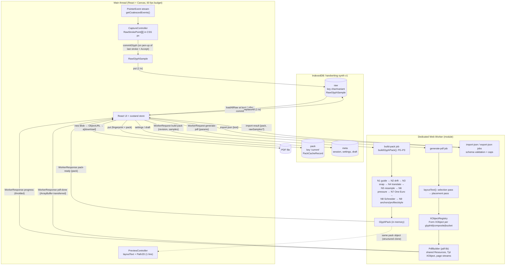

# Architecture.md — Handwriting Synthesis App

**Status:** Normative. Companion to `MathEngine.md` (which remains the sole authority for every constant, formula, and test vector). This document owns structure, boundaries, data flow, threading, memory, persistence, and import/export safety. Where this document needs a number that `MathEngine.md` does not define (page geometry, caps), it defines it here once, in a named constant, and no other file may redefine it.

**Product constraints (locked):** 100% client-side. Deterministic from a `uint32` seed. TypeScript + Vite + React, HTML5 Canvas, `pdf-lib`, IndexedDB, Web Workers. Zero ML. Zero backend, zero auth, zero billing, zero telemetry, zero network requests at runtime. Deployable as static files on any free tier (Cloudflare Pages, GitHub Pages, Netlify).

---

## 0. Stack and Non-Goals

| Concern | Choice | Notes |
|---|---|---|
| Language / build | TypeScript 5.x (strict), Vite 5.x | ES2022 target, ESM only |
| UI | React 18 + `zustand` | `zustand` is the only state library; ~1 KB |
| Ink preview / capture | HTML5 Canvas 2D | `Path2D` built from engine `PathCmd[]` |
| PDF | `pdf-lib` **1.17.1 (exact pin)** | imported **only** by `src/pdf/**` and `src/worker/pdf.worker.ts`; never in the main bundle |
| Persistence | IndexedDB, hand-rolled wrapper (~100 LOC) | no `idb`/`dexie` dependency |
| Concurrency | One dedicated module Web Worker | no `SharedArrayBuffer` (needs COOP/COEP headers, unavailable on some free tiers) |
| Tests | Vitest (node environment), `fake-indexeddb` | no browser test runner required |
| Runtime dependencies (complete list) | `react`, `react-dom`, `pdf-lib`, `zustand` | nothing else ships to users |

**Non-goals (explicitly excluded):** accounts, cloud sync, analytics, fonts embedded in PDFs, server rendering, service workers, ML models, WebAssembly, server-side PDF generation.

---

## 1. Repository and Directory Tree

```
handwriting-synth/
├─ .github/
│  └─ workflows/
│     └─ ci.yml                       # lint → typecheck → test → build → size check → Pages deploy
├─ docs/
│  ├─ MathEngine.md                   # normative math spec (source of truth)
│  ├─ Architecture.md                 # this file
│  └─ CHANGELOG.md                    # engine-spec revisions; bump ENGINE_SPEC_REV when math changes
├─ public/
│  └─ _headers                        # CSP + security headers (Cloudflare Pages / Netlify)
├─ scripts/
│  └─ check-size.mjs                  # fails the build if gzip bundle budgets are exceeded (§7.3)
├─ src/
│  ├─ engine/                         # PURE. No DOM, no React, no pdf-lib, no I/O. (§2)
│  │  ├─ index.ts                     # the ONLY public entry of the engine (barrel)
│  │  ├─ constants.ts                 # EM, K, CH, ENGINE_SPEC_REV (copied verbatim from MathEngine §0.3, §0.6, §4.1)
│  │  ├─ limits.ts                    # LIMITS (caps for capture, pack, import/export) (§5.2)
│  │  ├─ types.ts                     # Pt, CubicBezier, RawGlyphSample, NormalizedGlyph, GlyphPack, VarianceConfig, PathCmd, …
│  │  ├─ rng.ts                       # mix32, hash32, u01, gauss, perlin1, fnv1a32 (MathEngine §4.1, verbatim)
│  │  ├─ mathUtil.ts                  # wrap, clamp, smoothstep, median, vec ops, tanh
│  │  ├─ guides.ts                    # computeGuides(gB, xhPx) (MathEngine §0.4)
│  │  ├─ charset.ts                   # CAPTURE_CHARSET, MULTI_VARIANT_CHARS, X_CLASS, glyphClassOf(char), normalizeChar (smart quotes/dashes)
│  │  ├─ normalize/
│  │  │  ├─ pipeline.ts               # buildGlyphPack(): orchestrates passes P0–P3 (§3.2)
│  │  │  ├─ n1Guide.ts                # N1  px → em
│  │  │  ├─ n2Drift.ts                # N2  session scale-drift correction
│  │  │  ├─ n3Snap.ts                 # N3  punctuation/symbol class snapping
│  │  │  ├─ n4Translate.ts            # N4  x-translation + side bearings + bbox
│  │  │  ├─ n5Resample.ts             # N5  arc-length resampling, dot rule
│  │  │  ├─ n6Pressure.ts             # N6  pressure resolve/synthesize/taper
│  │  │  ├─ n7OneEuro.ts              # N7  One Euro smoothing
│  │  │  ├─ n8Schneider.ts            # N8  Schneider cubic Bezier fitting
│  │  │  ├─ n9Anchors.ts              # N9a entry/exit anchors + optical profiles
│  │  │  └─ n9Style.ts                # N9b StyleProfile (slant, aspect, weight, drift)
│  │  ├─ ink/
│  │  │  ├─ catmullRom.ts             # catmullRomToBeziers (MathEngine §3.5)
│  │  │  ├─ width.ts                  # pressure → ink width (§3.6)
│  │  │  ├─ ribbon.ts                 # variable-width ribbon outline → PathCmd[] (§3.7)
│  │  │  └─ ligatureOutline.ts        # ligature cubic → ribbon PathCmd[]
│  │  ├─ variance/
│  │  │  ├─ perVariance.ts            # F(k), θ, Δy_g, Δy_line, Δy_word, soft clamp, m_p, buckets (§4.3, §4.7)
│  │  │  ├─ perturb.ts                # control-point perturbation → NormalizedGlyph instance (§4.5)
│  │  │  ├─ variants.ts               # history-based variant selection (§4.6)
│  │  │  ├─ kerning.ts                # optical kerning δ_opt (§4.4)
│  │  │  ├─ ligature.ts               # compatibility test + ligature cubic (§4.4)
│  │  │  └─ placement.ts              # local-em → line-space transform (§4.3)
│  │  ├─ layout/
│  │  │  ├─ text.ts                   # text normalization, paragraph/word tokenization
│  │  │  ├─ layoutText.ts             # layoutText(): selection pass + placement pass → LayoutResult (§3.4)
│  │  │  ├─ templates.ts              # PAGE, TemplateSpec, TEMPLATE_SPECS, pageMetrics() (pure numbers only)
│  │  │  └─ instanceCache.ts          # InstanceCache: perturbed instances + outline PathCmd[] memo
│  │  └─ schema/
│  │     ├─ validate.ts               # ValidationIssue, ValidationResult, primitive checkers
│  │     ├─ glyphPackSchema.ts        # validateGlyphPack(), sanitizeGlyphPack()
│  │     ├─ rawSampleSchema.ts        # validateRawSample()
│  │     └─ packFile.ts               # parsePackFile(text), serializePackFile(), checksum (§5)
│  ├─ worker/
│  │  ├─ protocol.ts                  # WorkerRequest / WorkerResponse / params / stats types (shared by both sides; imports types only)
│  │  ├─ client.ts                    # MAIN-THREAD: WorkerClient (queue, AbortSignal bridge, watchdog). No pdf-lib import.
│  │  ├─ pdf.worker.ts                # WORKER ENTRY: 10-line shell wiring self.onmessage → dispatcher
│  │  ├─ dispatcher.ts                # handleRequest(req, post) — pure orchestration, testable without a Worker
│  │  ├─ jobs/
│  │  │  ├─ buildPackJob.ts           # build-pack
│  │  │  ├─ generatePdfJob.ts         # generate-pdf
│  │  │  ├─ importJob.ts              # import-json
│  │  │  └─ exportJob.ts              # export-json
│  │  └─ checkpoint.ts                # cooperative yield + cancellation + throttled progress
│  ├─ pdf/
│  │  ├─ num.ts                       # fmt(n, decimals) deterministic number formatting
│  │  ├─ pathOps.ts                   # PathCmd[] → PDF content-stream operators
│  │  ├─ matrix.ts                    # placementMatrix() (MathEngine §6.3), lineToPage()
│  │  ├─ xobjectRegistry.ts           # XObjectRegistry: (glyphId|composite|bucket) → PDFRef, lazy
│  │  ├─ templates/
│  │  │  ├─ ruled.ts                  # draws ruled background into an operator string
│  │  │  ├─ grid.ts
│  │  │  ├─ dotted.ts
│  │  │  ├─ cornell.ts
│  │  │  └─ index.ts                  # buildTemplateXObject(ctx, templateId) → PDFRef
│  │  └─ pdfBuilder.ts                # PdfBuilder: page assembly, shared Resources, save() → Uint8Array
│  ├─ canvas/
│  │  ├─ CaptureController.ts         # imperative PointerEvent capture → RawStrokePoint[][]; guides overlay
│  │  ├─ inkRenderer.ts               # PathCmd[] → Path2D; Path2D memo; draw glyph/line to a 2D context
│  │  ├─ PreviewController.ts         # live single-line preview (main thread, same engine code)
│  │  └─ viewport.ts                  # devicePixelRatio sizing; CSS-px ↔ canvas transforms (dpr never enters geometry)
│  ├─ components/
│  │  ├─ App.tsx
│  │  ├─ ErrorBoundary.tsx
│  │  ├─ capture/
│  │  │  ├─ CaptureWizard.tsx         # prompts next character from capture queue
│  │  │  ├─ CaptureCanvas.tsx         # hosts CaptureController; React never re-renders on pointermove
│  │  │  ├─ GuideCalibration.tsx      # sets gB and xhPx
│  │  │  └─ GlyphGallery.tsx          # review / redo captured glyphs
│  │  ├─ compose/
│  │  │  ├─ TextEditor.tsx
│  │  │  ├─ VariancePanel.tsx         # four sliders, mode, poolSize, seed re-roll
│  │  │  ├─ LivePreview.tsx           # hosts PreviewController
│  │  │  └─ TemplatePicker.tsx
│  │  └─ export/
│  │     ├─ ExportPanel.tsx           # PDF generation, progress, cancel, download
│  │     ├─ PackImportExport.tsx      # JSON import/export dialog with issue list
│  │     └─ ProgressBar.tsx
│  ├─ store/
│  │  ├─ db.ts                        # IndexedDB wrapper: open, get, put, getAll, clear, tx helpers
│  │  ├─ persistence.ts               # saveRawSample, loadAllRaw, savePackCache, loadPackCache, replaceAll
│  │  ├─ boot.ts                      # startup sequence (§3.3)
│  │  ├─ useAppStore.ts               # zustand store (slices below)
│  │  ├─ slices/
│  │  │  ├─ captureSlice.ts           # queue, guides, penWidthPx, nextSessionIndex
│  │  │  ├─ packSlice.ts              # pack, packStatus, fingerprint
│  │  │  ├─ composeSlice.ts           # text, VarianceConfig, template, xHeightPt, inkRgb
│  │  │  └─ jobSlice.ts               # current job id, phase, progress, warnings, last error
│  │  └─ download.ts                  # Blob → <a download>; revokeObjectURL scheduling
│  ├─ main.tsx
│  └─ vite-env.d.ts
├─ tests/
│  ├─ fixtures/
│  │  ├─ testVectors.ts               # literal inputs/outputs from MathEngine §5
│  │  └─ samplePack.ts                # tiny deterministic GlyphPack + RawGlyphSamples for pipeline/PDF tests
│  ├─ engine/
│  │  ├─ tv1.normalization.test.ts    # TV1A/1B/1C
│  │  ├─ tv2.curves.test.ts           # TV2A/2B/2C
│  │  ├─ tv3.variance.test.ts         # TV3A–3F
│  │  ├─ determinism.test.ts          # same inputs ⇒ deep-equal outputs; order-independence of k
│  │  ├─ layout.test.ts               # wrapping, retry-on-new-line, pagination, truncation
│  │  └─ pipeline.test.ts             # buildGlyphPack invariants (G1 continuity, profile length, advance)
│  ├─ schema/
│  │  ├─ glyphPackSchema.test.ts
│  │  ├─ packFile.test.ts             # round-trip, checksum, caps, hostile inputs
│  │  └─ hostile.test.ts              # __proto__, NaN-like numbers, depth/size bombs
│  ├─ pdf/
│  │  ├─ matrix.test.ts               # §6.3 matrix vs. §4.3 transform
│  │  ├─ pdfBuilder.test.ts           # object counts, XObject reuse, byte-identical re-run, size budget
│  │  └─ pathOps.test.ts
│  ├─ worker/
│  │  ├─ dispatcher.test.ts           # protocol, progress ordering, cancel, BUSY
│  │  └─ client.test.ts               # queue + AbortSignal + watchdog with a fake Worker
│  ├─ store/
│  │  └─ persistence.test.ts          # fake-indexeddb: fingerprint invalidation, corrupt cache recovery
│  └─ architecture/
│     └─ purity.test.ts               # scans src/engine for forbidden imports/globals (§2.4)
├─ index.html
├─ eslint.config.js
├─ package.json
├─ tsconfig.base.json
├─ tsconfig.json                      # app (DOM) project
├─ tsconfig.engine.json               # engine project: lib ES2022 only, no DOM, no node types (§2.3)
├─ tsconfig.worker.json               # worker project: lib ES2022 + WebWorker
├─ vite.config.ts
└─ vitest.config.ts
```

Path aliases (declared in `tsconfig.base.json` and mirrored in `vite.config.ts` / `vitest.config.ts`): `@engine` → `src/engine/index.ts` (barrel only), `@worker/*`, `@pdf/*`, `@canvas/*`, `@store/*`, `@components/*`. **Inside `src/engine/` all imports are relative.**

---

## 2. Boundary and Purity Rules

### 2.1 Dependency matrix (imports allowed: ✔, forbidden: ✘)

| Importer ↓ / Importee → | `engine` | `pdf` | `worker/protocol` | `worker/client` | `worker/(rest)` | `canvas` | `store` | `components` | `pdf-lib` | `react` |
|---|---|---|---|---|---|---|---|---|---|---|
| **`engine`** | ✔ (relative) | ✘ | ✘ | ✘ | ✘ | ✘ | ✘ | ✘ | **✘** | **✘** |
| **`pdf`** | ✔ (barrel) | ✔ | ✘ | ✘ | ✘ | ✘ | ✘ | ✘ | ✔ | ✘ |
| **`worker/protocol`** | ✔ (types) | ✘ | ✔ | ✘ | ✘ | ✘ | ✘ | ✘ | ✘ | ✘ |
| **`worker/client`** | ✔ (types) | ✘ | ✔ | ✔ | ✘ | ✘ | ✘ | ✘ | ✘ | ✘ |
| **`worker/(rest)`** (dispatcher, jobs, entry) | ✔ | ✔ | ✔ | ✘ | ✔ | ✘ | ✘ | ✘ | ✔ | ✘ |
| **`canvas`** | ✔ | ✘ | ✘ | ✘ | ✘ | ✔ | ✘ | ✘ | ✘ | ✘ |
| **`store`** | ✔ | ✘ | ✔ | ✔ | ✘ | ✘ | ✔ | ✘ | ✘ | ✘ |
| **`components`** | ✔ | ✘ | ✔ (types) | ✔ | ✘ | ✔ | ✔ | ✔ | ✘ | ✔ |

Consequences: the main bundle contains no `pdf-lib`; the worker bundle contains no React; `canvas` and `pdf` never see each other, so preview and PDF can only agree by sharing `@engine`.

### 2.2 The engine contract

`src/engine/**` is a library of pure functions and plain data. It must satisfy all of the following:

1. **No imports** except other files inside `src/engine/` (relative paths) — no npm packages, no `node:` modules.
2. **No ambient environment:** no `window`, `document`, `self`, `globalThis` access, `navigator`, `performance`, `indexedDB`, `localStorage`, `fetch`, `Worker`, `requestAnimationFrame`, `setTimeout`, `console`, `TextEncoder`, `crypto`, or any DOM type.
3. **No hidden nondeterminism:** no `Math.random`, no `Date.now`, no `new Date()`. Time enters only as an argument (`nowIso: string`). Randomness is exclusively `hash32/u01/gauss/perlin1` keyed by `(seed, index, channel)`.
4. **No module-level mutable state.** All caches and histories are objects created by the caller and passed in (`InstanceCache`, per-call `VariantHistory`). Importing the engine has no side effects (`"sideEffects": false` in `package.json`).
5. **No exceptions as control flow for user data.** Validators return `ValidationResult`; geometric routines handle degenerate input by the fallbacks written in `MathEngine.md` (e.g. zero-length tangent ⇒ `(1,0)`).
6. **Backend-neutral output.** Geometry leaves the engine as `Pt`, `CubicBezier`, or `PathCmd[]`:
   ```ts
   export type PathCmd =
     | { op: 'M'; x: number; y: number }
     | { op: 'C'; x1: number; y1: number; x2: number; y2: number; x: number; y: number }
     | { op: 'Z' };
   ```
   `src/canvas/inkRenderer.ts` converts `PathCmd[]` to `Path2D`; `src/pdf/pathOps.ts` converts it to `m / c / h` operators. Neither re-derives geometry.
7. **Typed arrays and plain objects only** cross the engine boundary, so everything is structured-cloneable.

### 2.3 Public engine API (what other layers may call)

```ts
// src/engine/index.ts (barrel) — signatures are normative
export function buildGlyphPack(
  samples: RawGlyphSample[],
  nowIso: string,
  onGlyph?: (done: number, total: number) => void   // called synchronously after each sample; used for progress only
): GlyphPack;

export class InstanceCache {
  constructor(pack: GlyphPack, cfg: VarianceConfig);
  instance(glyphId: string, composite: number): NormalizedGlyph;               // §4.5, memoized
  outline(glyphId: string, composite: number, bucket: 0 | 1 | 2): CachedOutline; // §3.7 PathCmd[] + bounds, memoized
}
export interface CachedOutline { path: PathCmd[]; minX: number; minY: number; maxX: number; maxY: number; }

export interface LayoutGeometry {
  lineWidthEm: number;      // (textRightPt - textLeftPt) / S
  linesPerPage: number;
  maxPages: number;         // 1..LIMITS.MAX_PAGES
}
export interface LigatureCubic {
  p0: Pt; p1: Pt; p2: Pt; p3: Pt;   // line space, em
  pressureStart: number;            // p_E
  pressureEnd: number;              // p_S
}
export interface Placement {
  k: number;                 // paragraph character index (spec §4.2)
  line: number;              // global line index L (spec §4.2)
  glyphId: string;           // `${char}#${variantIndex}`
  composite: number;         // e = v*M + m
  bucket: 0 | 1 | 2;         // pressure bucket (§4.7)
  originX: number;           // X_k, em from left margin
  dy: number;                // Δy after soft clamp
  thetaRad: number;          // θ
  pivX: number;              // (bbox.minX + bbox.maxX)/2 of the placed instance
  ligatureFromPrev: LigatureCubic | null;
}
export interface LayoutResult {
  placements: Placement[];   // ascending (line, originX)
  lineCount: number;
  pageCount: number;
  truncated: boolean;        // true if text exceeded maxPages
  consumedChars: number;
  missingChars: number[];    // paragraph-relative indices k of unavailable glyphs
}
export function layoutText(
  text: string, pack: GlyphPack, cfg: VarianceConfig,
  geom: LayoutGeometry, cache: InstanceCache
): LayoutResult;

export function ligatureOutline(lig: LigatureCubic, W: number, inkI: number): PathCmd[];
export function placementToLine(p: Placement, x: number, y: number): Pt;   // §4.3, used by tests and preview
export function validateGlyphPack(input: unknown): ValidationResult<GlyphPack>;
export function parsePackFile(text: string): ValidationResult<PackFileContents>;
export function serializePackFile(contents: PackFileContents, exportedAtIso: string): ValidationResult<string>;
export const TEMPLATE_SPECS: Record<TemplateId, TemplateSpec>;
export function pageMetrics(t: TemplateId, xHeightPt: number): PageMetrics;
export { EM, K, CH, LIMITS, DEFAULT_VARIANCE, ENGINE_SPEC_REV };
```

### 2.4 Enforcement (three independent layers; CI fails if any fails)

**(a) Compiler isolation — `tsconfig.engine.json`.** The engine is type-checked in a project that has no DOM and no Node typings, so ambient APIs do not exist at compile time:

```json
{
  "extends": "./tsconfig.base.json",
  "compilerOptions": {
    "lib": ["ES2022"],
    "types": [],
    "noEmit": true
  },
  "include": ["src/engine/**/*.ts"]
}
```

`npm run typecheck` runs `tsc -p tsconfig.json && tsc -p tsconfig.engine.json && tsc -p tsconfig.worker.json`.

**(b) Lint rules — `eslint.config.js` (flat config, excerpt).**

```js
import importPlugin from 'eslint-plugin-import';
import tseslint from 'typescript-eslint';

export default [
  ...tseslint.configs.recommended,
  {
    files: ['src/engine/**/*.ts'],
    plugins: { import: importPlugin },
    rules: {
      // 1. no bare-package imports and no node: builtins — relative paths only
      'no-restricted-imports': ['error', {
        patterns: [{ regex: '^(?!\\.{1,2}/).*', message: 'engine may import only relative engine files' }],
      }],
      // 2. engine can never reach into other layers, even relatively
      'import/no-restricted-paths': ['error', {
        zones: [{
          target: './src/engine',
          from: ['./src/worker', './src/pdf', './src/canvas', './src/components', './src/store', './tests'],
        }],
      }],
      // 3. ambient environment
      'no-restricted-globals': ['error',
        'window', 'document', 'self', 'globalThis', 'navigator', 'performance', 'indexedDB',
        'localStorage', 'sessionStorage', 'fetch', 'Worker', 'requestAnimationFrame',
        'setTimeout', 'setInterval', 'console', 'TextEncoder', 'TextDecoder', 'crypto',
        'structuredClone', 'process', 'require'],
      // 4. nondeterminism
      'no-restricted-properties': ['error',
        { object: 'Math', property: 'random', message: 'use hash32/u01/gauss' },
        { object: 'Date', property: 'now', message: 'pass time in as an argument' }],
      'no-restricted-syntax': ['error',
        { selector: "NewExpression[callee.name='Date']", message: 'pass time in as an argument' }],
    },
  },
  {
    // other layers must use the barrel, never engine internals
    files: ['src/{worker,pdf,canvas,components,store}/**/*.{ts,tsx}'],
    rules: {
      'no-restricted-imports': ['error', {
        patterns: [{ regex: '^@engine/.+', message: "import from '@engine' only" }],
      }],
    },
  },
  {
    // pdf-lib allowed only in pdf/ and the worker shell
    files: ['src/{components,canvas,store,engine}/**/*.{ts,tsx}', 'src/worker/{client,protocol}.ts'],
    rules: {
      'no-restricted-imports': ['error', { paths: [{ name: 'pdf-lib', message: 'pdf-lib is worker-side only' }] }],
    },
  },
];
```

**(c) Executable guard — `tests/architecture/purity.test.ts`.** Runs under Vitest (node environment) and fails on any regression the linter could miss (e.g. a disabled rule comment):

```ts
import { describe, it, expect } from 'vitest';
import { readdirSync, readFileSync, statSync } from 'node:fs';
import { join } from 'node:path';

const walk = (dir: string): string[] =>
  readdirSync(dir).flatMap((f) => {
    const p = join(dir, f);
    return statSync(p).isDirectory() ? walk(p) : p.endsWith('.ts') ? [p] : [];
  });

const FORBIDDEN_IMPORT = /from\s+['"](?!\.{1,2}\/)[^'"]+['"]|import\s*\(\s*['"](?!\.{1,2}\/)/;
const FORBIDDEN_GLOBAL = /\b(window|document|navigator|indexedDB|localStorage|requestAnimationFrame|fetch|Worker|performance\.now|Math\.random|Date\.now|new Date)\b/;
const ESLINT_DISABLE = /eslint-disable/;

describe('engine purity', () => {
  const files = walk('src/engine');
  it('has files', () => expect(files.length).toBeGreaterThan(20));
  for (const f of files) {
    it(`pure: ${f}`, () => {
      const src = readFileSync(f, 'utf8').replace(/\/\*[\s\S]*?\*\//g, '').replace(/\/\/.*$/gm, '');
      expect(src).not.toMatch(FORBIDDEN_IMPORT);
      expect(src).not.toMatch(FORBIDDEN_GLOBAL);
      expect(readFileSync(f, 'utf8')).not.toMatch(ESLINT_DISABLE);
    });
  }
});
```

### 2.5 One engine, two call sites (why preview equals PDF)

| Property | Main thread (live preview) | Worker (PDF) |
|---|---|---|
| Entry | `PreviewController` | `generatePdfJob` |
| Layout | `layoutText(previewText, pack, cfg, {lineWidthEm: previewWidthEm, linesPerPage: 1, maxPages: 1}, cache)` | `layoutText(text, pack, cfg, pageGeometry, cache)` |
| Cache | its own `InstanceCache` (rebuilt when pack or `cfg` changes) | its own `InstanceCache` per job |
| Output consumer | `inkRenderer` → `Path2D` → canvas | `pathOps` → Flate stream → `pdf-lib` |
| Shared | identical `@engine` code, identical `seed`, identical `VarianceConfig` | |

Guarantee: for identical `(pack, VarianceConfig, text, geometry)` the `LayoutResult` and every `PathCmd[]` are deep-equal between threads of the same browser (same JS engine ⇒ identical `Math.sin/cos/exp/log`). Across different browsers, floating-point results may differ in the last ulp; PDF coordinates are rounded to 1 decimal (em) / 4 and 2 decimals (matrix), which hides this except in rare rounding-boundary cases. Cross-browser byte-identity is therefore **not** promised; same-browser byte-identity is, and is tested (§4.6).

---

## 3. End-to-End Data Flow

### 3.1 Diagram



ASCII summary of the same flow:

```
PointerEvent ─▶ CaptureController ─▶ RawGlyphSample ─▶ IndexedDB.raw
                                                          │
                         (boot or new capture)            ▼
          store ──build-pack──▶ WORKER: N1→N2→N3→N4→N5→N6→N7→N8→N9 ──▶ GlyphPack
            ▲                                                            │
            │◀──────────── pack-ready ───────────────────────────────────┘
            ├──▶ IndexedDB.pack (fingerprint-keyed derived cache)
            ├──▶ PreviewController (main thread, 1 line, same engine)
            └──generate-pdf──▶ WORKER: layoutText ─▶ XObjectRegistry ─▶ PdfBuilder
                                  │ progress…                              │
                                  ▼                                        ▼
                               UI progress                    ArrayBuffer (transferred)
                                                                           │
                                                      Blob ─▶ ObjectURL ─▶ download
```

### 3.2 Normalization stages mapped to code

The pipeline is **pack-level in two places** (`W` needs all samples; drift needs all X-class samples), so `buildGlyphPack` runs four passes. Order of the per-point stages is exactly `MathEngine.md` §0.5.

| Pass | Stage | File | Input → Output | Scope |
|---|---|---|---|---|
| **P0** | §2.1 | `pipeline.ts` | `s_i = 300/xhPx_i`, `W_i = penWidthPx_i·s_i`; `W = median(W_i)` | all samples |
| **P1** | **N1** | `n1Guide.ts` | px → em (`x1`, `y1`) | each sample |
| **P1** | **N2** | `n2Drift.ts` | `b`, `ī`; `k_i` scale about baseline | all samples (fit), each sample (apply) |
| **P2** | **N3** | `n3Snap.ts` | vertical snap for punctuation/symbols using outline bbox `centerline ± W/2` | each sample |
| **P2** | **N4** | `n4Translate.ts` | `x4`, `y4`, `bbox`, `advance`, side bearings | each sample |
| **P2** | §2.7 slant | `n9Style.ts` | `measuredSlantDeg` from N4 points (chord only) | each sample |
| **P2** | **N5** | `n5Resample.ts` | arc-length points every 9 em, dot rule | each stroke |
| **P2** | **N6** | `n6Pressure.ts` | resolved/synthesized pressure + taper | each stroke |
| **P2** | **N7** | `n7OneEuro.ts` | filtered `(x, y)` (ends pinned) | each stroke |
| **P2** | **N8** | `n8Schneider.ts` | `CubicBezier[]` (G1) + `PressureKnot[]` | each stroke |
| **P2** | **N9a** | `n9Anchors.ts` | `entry`, `exit`, `leftProfile`, `rightProfile` | each glyph |
| **P3** | **N9b** | `n9Style.ts` | `StyleProfile` (`slantDeg`, `aspectRatio`, `strokeWeight`, drift) | all glyphs |
| **P3** | assemble | `pipeline.ts` | `GlyphPack` with `glyphs[char]` sorted by `variantIndex`; chars inserted in ascending code-point order; `createdAt = nowIso` | pack |

Determinism notes: iteration order is always sorted (`char` by code point, then `variantIndex`), never `Object.keys` insertion order of user data. `Array.prototype.sort` is called only with explicit comparators.

### 3.3 IndexedDB layout and boot sequence

Database `handwriting-synth`, version `1`:

| Object store | Key | Value | Purpose |
|---|---|---|---|
| `raw` | out-of-line: `` `${char}#${variantIndex}` `` | `RawGlyphSample` | immutable source of truth (MathEngine §1.1) |
| `pack` | `'current'` | `PackCacheRecord` | derived, versioned cache of `GlyphPack` |
| `meta` | `'session'`, `'settings'`, `'draft'` | see below | session counters, UI/variance settings, text draft |

```ts
// src/store/persistence.ts
export interface PackCacheRecord {
  engineSpec: string;          // = ENGINE_SPEC_REV (constants.ts), e.g. 'MathEngine/1'
  sourceFingerprint: string;   // 8-hex fnv1a32 over the sorted raw-sample manifest (below)
  pack: GlyphPack;
  savedAt: string;             // ISO-8601, from the UI layer
}
export interface SessionMeta { nextSessionIndex: number; guideBaselinePx: number; guideXHeightPx: number; penWidthPx: number; }
export interface SettingsMeta {
  variance: VarianceConfig; template: TemplateId; xHeightPt: number;
  inkRgb: [number, number, number]; maxPages: number;
}
```

Fingerprint manifest string (stable, order-independent of insertion):

```
sorted keys → for each: `${key}|${sessionIndex}|${capturedAt}|${totalPointCount}`  joined by '\n'
sourceFingerprint = hex8(fnv1a32(manifest))
```

**Boot (`boot.ts`):**

1. Open DB. If `indexedDB` is unavailable or `open` fails, continue with an in-memory store and show a persistent "changes will not be saved" banner (no crash).
2. Read `meta` (`session`, `settings`, `draft`); apply defaults from `DEFAULT_VARIANCE` and template defaults when absent.
3. `loadAllRaw()` → validate each with `validateRawSample`; quarantine invalid records (kept in DB, excluded from the pack, listed in the gallery as "unreadable — redo").
4. Compute `sourceFingerprint`. Read `pack/current`. Accept the cache **only if** `engineSpec === ENGINE_SPEC_REV` **and** fingerprint matches **and** `validateGlyphPack(record.pack).ok`.
5. Otherwise send `build-pack` to the worker, then write the resulting `PackCacheRecord` (single `put`).
6. Request `navigator.storage.persist()` once, on first successful capture commit (failure is ignored).

Writes: committing a glyph is one `readwrite` transaction on `raw` (+ `meta.session`). Rebuild is debounced 400 ms after the last commit and runs only in the worker. **The derived cache is never the source of truth: deleting `pack` loses nothing.**

Capture-time re-capture of an existing key replaces the record and takes `sessionIndex = nextSessionIndex++` (monotonic capture order, which is what the §2.3 drift regression models).

### 3.4 Layout module contract (how §4.2–§4.6 are applied)

`layoutText` is a two-pass algorithm per word so that wrapping never corrupts state:

1. **Selection pass (X-independent).** For each character of the word, in order, run §4.6 (`variants.ts`) to choose the composite id `e`, compute `m_p → bucket`, `θ`, `Δy_g`, `Δy_word`. These depend only on `(seed, k, w, history)` and are therefore computed **once**; the per-character variant history is mutated here and only here.
2. **Placement pass (X- and L-dependent, retryable).** Compute `X_k` (kerning §4.4, `δ_var`, ligature test), `Δy_line(X_k, L)`, soft clamp, `pivX`. If the word's last glyph would satisfy `X + adv > lineWidthEm` and the word does not start at `X = 0`, discard the placement result, set `L += 1`, `X = 0`, and run the placement pass again (selection results are reused unchanged).

Implementation rules adopted from `MathEngine.md` §4.4 literally: smart quotes/dashes normalized before lookup; missing glyph ⇒ advance `0.6·K.WORD_SPACE`, index recorded in `missingChars`; tab ⇒ `4·K.WORD_SPACE`; single `\n` ⇒ `X = 0, L += 1`; `\n\n` ⇒ `X = 0, L += 1, k = 0, w = 0`. `L` is global; the page of a line is `floor(L / linesPerPage)` and its row is `L mod linesPerPage`. Layout stops as soon as `L` reaches `maxPages · linesPerPage` (`truncated = true`), so memory and time are bounded by the page limit rather than input size.

Page geometry (pure numbers, `src/engine/layout/templates.ts`):

```ts
export const PAGE = { widthPt: 595.276, heightPt: 841.89 } as const;   // A4
export type TemplateId = 'ruled' | 'grid' | 'dotted' | 'cornell';

export interface TemplateSpec {
  id: TemplateId;
  linePitchPt: number;            // baseline-to-baseline distance
  textLeftPt: number;             // x of line-space X = 0
  textRightPt: number;            // right edge of writable area
  firstBaselineFromTopPt: number; // y of the first baseline, measured from the top edge
  linesPerPage: number;
}

export const TEMPLATE_SPECS: Record<TemplateId, TemplateSpec> = {
  ruled:   { id: 'ruled',   linePitchPt: 28.346, textLeftPt: 56.693,  textRightPt: 552.756, firstBaselineFromTopPt: 113.385, linesPerPage: 24 },
  grid:    { id: 'grid',    linePitchPt: 28.346, textLeftPt: 56.693,  textRightPt: 552.756, firstBaselineFromTopPt: 113.385, linesPerPage: 24 },
  dotted:  { id: 'dotted',  linePitchPt: 28.346, textLeftPt: 56.693,  textRightPt: 552.756, firstBaselineFromTopPt: 113.385, linesPerPage: 24 },
  cornell: { id: 'cornell', linePitchPt: 28.346, textLeftPt: 240.945, textRightPt: 552.756, firstBaselineFromTopPt: 113.385, linesPerPage: 18 },
};

export interface PageMetrics { S: number; lineWidthEm: number; linePitchEm: number; xHeightPt: number; }
// S = xHeightPt / EM.xHeight (points per em unit). xHeightPt is clamped to [6, 10.5] so that
// linePitchEm = linePitchPt / S >= 800 (= ascender-to-descender span 700-100 + 900-700 ... i.e. 600 + 200), preventing line collisions.
export function pageMetrics(t: TemplateId, xHeightPt: number): PageMetrics;
```

Default `xHeightPt = 10` ⇒ `S = 1/30`, `lineWidthEm(ruled) = 14 882.3`, ≈ 60–65 characters per ruled line, ≈ 1 500 characters per page. Template background geometry (rule colors, grid/dot pitch of 14.173 pt = 5 mm, Cornell cue column and summary box) lives in `src/pdf/templates/*.ts` and is purely cosmetic; it never feeds back into layout.

---

## 4. Web Worker and Memory Architecture

### 4.1 Threading model

* **Exactly one** dedicated module worker, created lazily by `WorkerClient` on first use:
  `new Worker(new URL('./pdf.worker.ts', import.meta.url), { type: 'module' })`.
* **One job at a time.** `WorkerClient` owns a FIFO queue; the worker additionally replies `BUSY` if it ever receives a job while one is running (defense in depth).
* The worker holds the **current `GlyphPack` and its `revision`** after a `build-pack` or `load-pack`, so `generate-pdf` messages do not re-send the pack.
* Everything above ~8 ms of CPU runs in the worker: pack building, layout of full documents, outline generation, PDF assembly, JSON parse/validate/stringify. The main thread keeps only: pointer handling, one-line preview, React rendering.

### 4.2 Typed message protocol (`src/worker/protocol.ts`)

```ts
import type { GlyphPack, RawGlyphSample, VarianceConfig, TemplateId, ValidationIssue } from '@engine';

export type JobId = string;                 // `${kind}-${monotonicCounter}` assigned by WorkerClient

export interface GeneratePdfParams {
  packRevision: number;                     // must equal the worker's loaded revision
  text: string;                             // length <= LIMITS.MAX_TEXT_CHARS
  variance: VarianceConfig;
  template: TemplateId;
  xHeightPt: number;                        // clamped to [6, 10.5] by pageMetrics
  inkRgb: [number, number, number];         // each 0..1; default [0, 0, 0]
  maxPages: number;                         // 1..LIMITS.MAX_PAGES (10)
  documentDateIso: string;                  // used for PDF CreationDate/ModDate (keeps output deterministic)
}

export type WorkerRequest =
  | { type: 'build-pack';   jobId: JobId; revision: number; samples: RawGlyphSample[]; nowIso: string }
  | { type: 'load-pack';    jobId: JobId; revision: number; pack: GlyphPack }
  | { type: 'generate-pdf'; jobId: JobId; params: GeneratePdfParams }
  | { type: 'import-json';  jobId: JobId; text: string }
  | { type: 'export-json';  jobId: JobId; pack: GlyphPack; rawSamples: RawGlyphSample[] | null; exportedAtIso: string }
  | { type: 'cancel';       jobId: JobId };

export type Phase = 'validate' | 'normalize' | 'layout' | 'emit' | 'finalize';

export interface ProgressInfo {
  phase: Phase;
  fraction: number;           // 0..1 overall for the job, monotonic non-decreasing
  pagesDone: number; pagesTotal: number;
  glyphsDone: number; glyphsTotal: number;
  xobjectsBuilt: number;
  bytesEstimate: number;      // Flate bytes written so far (XObjects + page streams)
}

export interface PdfStats {
  pages: number; glyphsPlaced: number; xobjects: number; ligatures: number;
  bytes: number; durationMs: number; truncated: boolean;
  missingChars: number[];     // paragraph-relative indices (capped to the first 200)
}

export type ErrorCode =
  | 'VALIDATION_FAILED' | 'PACK_NOT_LOADED' | 'REVISION_MISMATCH' | 'LIMIT_EXCEEDED'
  | 'EMPTY_TEXT' | 'NO_GLYPHS' | 'BUSY' | 'UNSUPPORTED_REQUEST' | 'INTERNAL';

export type WorkerResponse =
  | { type: 'ready' }
  | { type: 'progress';      jobId: JobId; info: ProgressInfo }
  | { type: 'pack-ready';    jobId: JobId; revision: number; pack: GlyphPack }
  | { type: 'pdf-done';      jobId: JobId; buffer: ArrayBuffer; stats: PdfStats; warnings: PdfWarning[] }
  | { type: 'import-result'; jobId: JobId; ok: true;  pack: GlyphPack; rawSamples: RawGlyphSample[] | null }
  | { type: 'import-result'; jobId: JobId; ok: false; issues: ValidationIssue[] }
  | { type: 'export-result'; jobId: JobId; ok: true;  json: string }
  | { type: 'export-result'; jobId: JobId; ok: false; issues: ValidationIssue[] }
  | { type: 'cancelled';     jobId: JobId }
  | { type: 'error';         jobId: JobId; code: ErrorCode; message: string };

export type PdfWarning =
  | { code: 'TRUNCATED';        message: string }
  | { code: 'MISSING_GLYPHS';   message: string }
  | { code: 'SIZE_OVER_BUDGET'; message: string };   // final bytes > LIMITS.PDF_BUDGET_BYTES
```

Ordering guarantees: for any `jobId`, zero or more `progress` messages, then **exactly one** terminal message (`pack-ready`, `pdf-done`, `import-result`, `export-result`, `cancelled`, or `error`). `progress.fraction` never decreases. A `cancel` for an unknown or finished `jobId` is ignored.

### 4.3 Main-thread client (`src/worker/client.ts`)

```ts
export class WorkerClient {
  constructor(factory: () => Worker = defaultFactory);

  buildPack(samples: RawGlyphSample[], nowIso: string, opts?: JobOpts): Promise<{ revision: number; pack: GlyphPack }>;
  loadPack(pack: GlyphPack, opts?: JobOpts): Promise<{ revision: number }>;
  generatePdf(params: Omit<GeneratePdfParams, 'packRevision'>, opts?: JobOpts & { onProgress?: (p: ProgressInfo) => void }):
    Promise<{ blob: Blob; stats: PdfStats; warnings: PdfWarning[] }>;
  importJson(text: string, opts?: JobOpts): Promise<ImportOutcome>;
  exportJson(pack: GlyphPack, rawSamples: RawGlyphSample[] | null, exportedAtIso: string, opts?: JobOpts): Promise<ValidationResult<string>>;
  dispose(): void;
}
export interface JobOpts { signal?: AbortSignal }
```

Behavior:

* **Cancellation bridge.** If `signal` is already aborted, the promise rejects with `DOMException('Aborted','AbortError')` without posting. Otherwise `signal.addEventListener('abort', …)` posts `{type:'cancel', jobId}`. The promise rejects with `AbortError` when `cancelled` arrives. If a queued (not yet started) job is aborted it is removed from the queue and rejected immediately.
* **Hard-cancel fallback.** If `cancelled` has not arrived 1 000 ms after posting `cancel`, the client calls `worker.terminate()`, spawns a fresh worker, re-sends the last `load-pack`, and rejects the job with `AbortError`. (Covers a worker stuck inside a single long synchronous call.)
* **Watchdog.** If a running job produces no message for 10 000 ms, the client terminates/respawns the worker and rejects with `Error('worker stalled')`.
* **Blob creation.** On `pdf-done`: `new Blob([buffer], { type: 'application/pdf' })`. The `ArrayBuffer` was **transferred**, not copied.
* **Typed pack revisions.** `revision` is a monotonically increasing integer owned by the store; `generatePdf` fills `packRevision` automatically from the last `pack-ready`/`load-pack`.

### 4.4 Cooperative cancellation and yielding in the worker (`checkpoint.ts`)

Workers cannot receive an `AbortSignal`, and `onmessage` fires only when the worker yields. Therefore every long loop calls `checkpoint()`:

```ts
// src/worker/checkpoint.ts
export class CancelledError extends Error {}

export interface CheckpointCtx {
  jobId: string;
  post: (msg: WorkerResponse, transfer?: Transferable[]) => void;
  cancelled: Set<string>;                 // filled by the dispatcher on 'cancel'
  now: () => number;                      // performance.now in production; injectable in tests
}

const yieldToEventLoop = (): Promise<void> =>
  new Promise((resolve) => { const ch = new MessageChannel(); ch.port1.onmessage = () => { ch.port1.close(); resolve(); }; ch.port2.postMessage(0); });

export function makeCheckpoint(ctx: CheckpointCtx, sliceMs = 12, progressEveryMs = 100) {
  let sliceStart = ctx.now();
  let lastProgress = -Infinity;
  return async function checkpoint(info?: () => ProgressInfo, force = false): Promise<void> {
    const t = ctx.now();
    if (info && (force || t - lastProgress >= progressEveryMs)) {
      ctx.post({ type: 'progress', jobId: ctx.jobId, info: info() });
      lastProgress = t;
    }
    if (force || t - sliceStart >= sliceMs) {
      await yieldToEventLoop();                       // lets onmessage('cancel') run
      if (ctx.cancelled.has(ctx.jobId)) throw new CancelledError();
      sliceStart = ctx.now();
    }
  };
}
```

Call sites (all required): after each sample in `buildPackJob`; after layout of each paragraph; after every 400 placements and at every page boundary in `generatePdfJob`; once before `save()`. The dispatcher catches `CancelledError`, posts `{type:'cancelled'}`, and **drops every reference** held by the job (registry, builder, layout) so the garbage collector can reclaim it before the next job.

### 4.5 `generate-pdf` job: step by step (`jobs/generatePdfJob.ts`)

1. **Validate** params (`PACK_NOT_LOADED`, `REVISION_MISMATCH`, `EMPTY_TEXT`, text length ≤ `LIMITS.MAX_TEXT_CHARS`, `maxPages` ∈ 1..10). Clamp `xHeightPt` through `pageMetrics`.
2. `cache = new InstanceCache(pack, params.variance)`; `metrics = pageMetrics(template, xHeightPt)`.
3. `layout = layoutText(text, pack, variance, { lineWidthEm: metrics.lineWidthEm, linesPerPage: spec.linesPerPage, maxPages }, cache)` — bounded by `maxPages` (§3.4). Emit `progress{phase:'layout'}`.
4. `builder = new PdfBuilder({ documentDateIso, template, inkRgb })`. The builder:
   * creates the `PDFDocument` with `PDFDocument.create({ updateMetadata: false })`, then sets Producer, Creator, CreationDate and ModificationDate explicitly (`documentDateIso`), so no wall-clock value enters the file;
   * builds **one** Form XObject `Tpl` containing the template background (rules/grid/dots/Cornell lines) as vector paths;
   * creates **one** shared, indirect `/Resources` dictionary `{ /XObject << /Tpl … /G1 … /G2 … >> }` which every page references (new glyph XObjects are added to this same dictionary as they are created).
5. For each page `pg` in `0..pageCount-1`: group `layout.placements` by `floor(line / linesPerPage)`; emit one content stream:
   ```
   q 0 0 0 rg                                  % ink color (inkRgb)
   /Tpl Do                                     % (drawn before ink; template stroke colors are set inside Tpl)
   q a b c d e f cm /G12 Do Q                  % per placement (§6.3 matrix; 4/4/4/4/2/2 decimals)
   <ligature path ops in page points, 2 decimals> f   % per ligature
   Q
   ```
   The page content is assembled as an array of strings, joined once, passed through `ctx.flateStream`, registered, and attached via `page.node.addContentStream(ref)`. The array and string are dropped before the next page.
6. Glyph XObject on first use: `registry.get(glyphId, composite, bucket)`:
   ```ts
   const out = cache.outline(glyphId, composite, bucket);            // PathCmd[] in em space
   const ops = pathToOps(out.path, 1) + 'f';                          // m/c/h … f, nonzero rule, 1 decimal
   const bbox = [floor(out.minX) - 1, floor(out.minY) - 1, ceil(out.maxX) + 1, ceil(out.maxY) + 1];
   const stream = ctx.flateStream(ops, { Type: 'XObject', Subtype: 'Form', FormType: 1, BBox: bbox, Resources: {} });
   const ref = ctx.register(stream);
   ```
   XObject names are `G1, G2, …` assigned **in first-use order**, which is deterministic because layout order is deterministic.
7. **Size accounting.** After each stream registration, `bytesEstimate += stream.getContentsSize()`. When `bytesEstimate` crosses `0.9 · LIMITS.PDF_BUDGET_BYTES`, a `SIZE_OVER_BUDGET` warning is queued (reported only if the final size actually exceeds the budget). **The worker never silently changes variance or quality to fit the budget**; the UI tells the user which knobs reduce size (lower `poolSize`, ink slider, semi-cursive off).
8. `finalize`: `bytes = await pdfDoc.save({ useObjectStreams: true, addDefaultPage: false })`; `postMessage({type:'pdf-done', buffer: bytes.buffer, …}, [bytes.buffer])`.

### 4.6 Memory and XObject lifecycle

| Object | Created | Lives until | Bound |
|---|---|---|---|
| `GlyphPack` (worker copy) | `build-pack` / `load-pack` | next `build-pack`/`load-pack` | ≤ 16 MiB JSON equivalent (import cap); typically < 1.5 MB |
| `InstanceCache` | job start | job end (cancel, error, or done) | ≤ `nChars · nBase · poolSize` instances ≈ 100 · 1.4 · 4 ≈ 560 normal / ≤ 1 100 worst case; ~10 KB each ⇒ ≤ ~11 MB |
| Outline memo (`PathCmd[]`) | first request per `(glyphId, composite, bucket)` | job end | ≤ `instances · 3` ≈ 1 700 typical |
| `XObjectRegistry` (`Map<string, PDFRef>`) | job start | job end | same count; holds refs only (the bytes live inside `pdf-lib`, already Flate-compressed) |
| `LayoutResult.placements` | after layout | job end | ≤ ~14 000 placements × ~120 B ≈ 1.7 MB |
| Per-page operator string | per page | end of that page | ≈ 13 000 glyphs / 10 pages ⇒ ≈ 60 KB raw per page |
| Final `Uint8Array` | `save()` | transferred to main thread | < 2 MB target |

Rules that keep the output under 2 MB (from `MathEngine.md` §6, now structural):

1. **Glyphs are never emitted inline.** Every placed glyph is `q a b c d e f cm /Gn Do Q` (~45 B). No per-placement outlines.
2. **One XObject per `(glyphId, composite, bucket)` per document**, so the ink-variance (pool × buckets) is what bounds size, not text length. Worst case ≈ `nBase · M · 3` XObjects per character.
3. **Page background is one shared `Tpl` XObject**, drawn with `Do` on every page (10 pages cost one copy).
4. **One shared `/Resources` dictionary** for all pages.
5. **Flate everywhere:** XObjects, page content streams, and the template stream use `context.flateStream`; the file is saved with object streams.
6. **Numeric precision is fixed:** XObject coordinates 1 decimal (em); matrix `a b c d` 4 decimals, `e f` 2 decimals; ligature paths 2 decimals (points). `fmt()` strips trailing zeros and normalizes `-0` to `0`.
7. **No fonts, no images, no ICC profiles, no metadata streams** beyond `pdf-lib`'s Info dictionary. Cornell labels are omitted for this reason (no text ⇒ no embedded font).

Budget model (default settings, 10 pages, ≈ 13 000 glyphs): XObjects ≈ 1 700 × 350 B ≈ 0.6 MB; placements ≈ 13 000 × 45 B ≈ 0.6 MB raw ≈ 0.2 MB Flate; template ≈ 10 KB; ligatures (semi-cursive only) ≈ 100 B each. Expected total ≈ 0.8–1.2 MB. `LIMITS.PDF_BUDGET_BYTES = 2_000_000`.

Pages cannot reuse XObjects across **documents**; the registry is intentionally per job so a document is self-contained and reproducible.

### 4.7 Not blocking the UI thread

| Work | Where | Budget |
|---|---|---|
| `pointermove` capture handler | main | ≤ 1 ms: push one `RawStrokePoint`, schedule a `requestAnimationFrame` redraw of only the new segment |
| Capture redraw | main (`CaptureController`) | incremental stroke drawing; no React state updates during a stroke |
| Live preview (one line, ≈ 60 glyphs) | main (`PreviewController`) | ≤ 6 ms per update (cached outlines ⇒ `Path2D` reuse); updates are coalesced to one per animation frame; if the previous update exceeded 8 ms, the next is deferred one frame |
| Pack build (≈ 100 samples) | worker | tens of ms; progress per sample |
| Full-document layout + PDF | worker | seconds; progress ≥ every 100 ms; cancel latency ≤ one slice (12 ms) plus one yield |
| JSON import/export parse, validate, stringify | worker | any size up to the 16 MiB cap |
| IndexedDB I/O | main (async by nature) | structured-clone cost only; no sync work |

React rule: components subscribe to narrow `zustand` selectors; progress updates are throttled by the worker (≥ 100 ms apart), so the UI re-renders at most ~10 times per second during export.

Download (`store/download.ts`): `const url = URL.createObjectURL(blob)`; create an `<a download="handwriting.pdf">`, `click()`, then `setTimeout(() => URL.revokeObjectURL(url), 10_000)`.

---

## 5. Validation and Import/Export Safety

All of this code lives in `src/engine/schema/` (pure, so the same validator runs in the worker for imports, on the main thread when loading IndexedDB at boot, and in tests). It is **parse-don't-validate**: the validator never returns the input object; it builds a **new sanitized object** by reading only whitelisted keys.

### 5.1 File format

```ts
export interface PackFileContents { pack: GlyphPack; rawSamples: RawGlyphSample[] | null; }

export interface PackFile {
  format: 'handwriting-glyphpack';
  formatVersion: 1;
  engineSpec: string;               // must equal ENGINE_SPEC_REV
  exportedAt: string;               // ISO-8601, supplied by the caller (engine never reads the clock)
  checksum: string;                 // 8 lowercase hex chars: fnv1a32(JSON.stringify({ pack, rawSamples }))
  pack: GlyphPack;                  // GlyphPack.version === 1, unitsPerEm === 1000
  rawSamples?: RawGlyphSample[];    // optional; when present, the pack can be re-derived exactly
}
```

* Export is **lossless** (full-precision numbers; no rounding), so `import(export(x))` deep-equals `x`.
* The checksum detects accidental corruption and truncated downloads; it is **not** a security feature. Mismatch ⇒ issue `CHECKSUM_MISMATCH` (the user may still choose "import anyway" only if every other check passed; the default is reject).
* Import mode is **replace-only**: a successful import clears `raw`, `pack`, and `meta.session`, then writes the new data in a single IndexedDB transaction. There is no merge (keeps the system deterministic and small). If `rawSamples` is absent, `raw` stays empty, the pack is stored as the cache record with `sourceFingerprint = 'imported'`, and the gallery shows "imported pack (no raw samples)"; capture can resume and will replace the pack on the next build.

### 5.2 Caps (`src/engine/limits.ts`, the only definition)

```ts
export const LIMITS = {
  // files and text
  MAX_FILE_BYTES: 16_777_216,             // 16 MiB, checked on File.size before reading AND on string length after
  MAX_TEXT_CHARS: 30_000,                 // document text accepted by generate-pdf
  MAX_PAGES: 10,
  PDF_BUDGET_BYTES: 2_000_000,

  // pack-level
  MAX_GLYPH_CHARS: 256,                   // distinct characters in pack.glyphs
  MAX_VARIANTS_PER_CHAR: 3,
  MAX_STROKES_PER_GLYPH: 16,
  MAX_SEGMENTS_PER_STROKE: 512,
  MAX_PRESSURE_KNOTS_PER_STROKE: 2_048,
  MAX_SEGMENTS_PER_PACK: 150_000,

  // raw samples (capture and import use the same caps)
  MAX_RAW_SAMPLES: 768,                   // 256 chars × 3 variants
  MAX_RAW_STROKES_PER_SAMPLE: 16,
  MAX_RAW_POINTS_PER_STROKE: 4_000,
  MAX_RAW_POINTS_PER_SAMPLE: 20_000,
  MAX_RAW_POINTS_TOTAL: 120_000,

  // numeric ranges
  EM_X_MIN: -200, EM_X_MAX: 4_000,        // normalized glyph x (em)
  EM_Y_MIN: -1_000, EM_Y_MAX: 2_000,      // normalized glyph y (em)
  RAW_PX_MIN: -1_000, RAW_PX_MAX: 10_000, // raw canvas px
  RAW_PEN_WIDTH_MIN: 0.5, RAW_PEN_WIDTH_MAX: 200,
  RAW_XHEIGHT_PX_MIN: 20, RAW_XHEIGHT_PX_MAX: 2_000,

  // reporting
  MAX_ISSUES: 25,
} as const;
```

Capture enforces the raw caps while drawing: when a stroke reaches `MAX_RAW_POINTS_PER_STROKE` it is ended automatically; a sample cannot exceed `MAX_RAW_STROKES_PER_SAMPLE`/`MAX_RAW_POINTS_PER_SAMPLE`; the UI says so. Therefore **any file the app exports is guaranteed to import**.

### 5.3 Validation pipeline (`parsePackFile`), in order, fail-fast per stage

| # | Stage | Checks | Issue codes |
|---|---|---|---|
| 0 | **Pre-read (UI/main thread)** | `file.size ≤ MAX_FILE_BYTES` before calling `file.text()`; extension `.json` (advisory only) | `FILE_TOO_LARGE` |
| 1 | **Size (worker)** | `text.length ≤ MAX_FILE_BYTES` | `FILE_TOO_LARGE` |
| 2 | **Parse** | `JSON.parse` inside `try/catch`; top level must be a non-array object | `JSON_SYNTAX`, `NOT_OBJECT` |
| 3 | **Envelope** | exactly the keys `format, formatVersion, engineSpec, exportedAt, checksum, pack, rawSamples?`; `format` and `formatVersion` literals; `engineSpec === ENGINE_SPEC_REV`; `exportedAt` matches `^\d{4}-\d{2}-\d{2}T\d{2}:\d{2}:\d{2}(\.\d{1,3})?(Z\|[+-]\d{2}:\d{2})$`; `checksum` matches `^[0-9a-f]{8}$` | `BAD_FORMAT`, `UNSUPPORTED_VERSION`, `ENGINE_SPEC_MISMATCH`, `BAD_DATE`, `UNKNOWN_KEY` |
| 4 | **Pack schema** (builds sanitized copy) | see §5.4 | `BAD_TYPE`, `OUT_OF_RANGE`, `NOT_FINITE`, `BAD_KEY`, `UNKNOWN_KEY`, `MISSING_KEY` |
| 5 | **Derived invariants** | see §5.4 | `INVARIANT_FAILED` |
| 6 | **Aggregate caps** | counts against `LIMITS` while walking (checked **before** allocating arrays of that size — counts come from `.length` of parsed arrays, and per-glyph checks run before per-segment loops so an oversized glyph is rejected in O(1)) | `CAP_EXCEEDED` |
| 7 | **Raw samples** (if present) | `validateRawSample` for each; `(char, variantIndex)` unique; `sessionIndex` unique non-negative integers; guides strictly ordered `ascenderY < xHeightY < baselineY < descenderY` | same codes |
| 8 | **Checksum** | recompute `fnv1a32(JSON.stringify({ pack: sanitizedPack, rawSamples: sanitizedRaw ?? null }))`; compare | `CHECKSUM_MISMATCH` |

Result types:

```ts
export interface ValidationIssue { path: string; code: IssueCode; message: string; }   // path is a JSON Pointer, e.g. "/pack/glyphs/a/0/strokes/1/segments/3/p1/x"
export type ValidationResult<T> =
  | { ok: true; value: T }
  | { ok: false; issues: ValidationIssue[] };       // at most LIMITS.MAX_ISSUES; validation stops collecting after that
```

### 5.4 Pack schema rules (stage 4–5)

**Primitive rules.** Numbers must be `typeof 'number'`, `Number.isFinite`, and within the stated range; integers use `Number.isInteger`. Strings have explicit maximum lengths. Booleans are strict. Arrays are checked with `Array.isArray` and a length cap **before** iteration. Every object is checked against an exact key whitelist; **unknown keys are rejected** (`UNKNOWN_KEY`), which also blocks prototype-pollution vectors (`__proto__`, `constructor`, `prototype` are never whitelisted, and the sanitizer never uses `Object.assign`/spread on input objects).

**`GlyphPack`:** `version === 1`; `unitsPerEm === 1000`; `metrics` deep-equals `EM`; `createdAt` ISO-8601; `style` has finite numbers (`slantDeg ∈ [-90, 90]`, `aspectRatio ∈ (0, 20]`, `strokeWeight ∈ (0, 400]`, `driftSlopePerIndex ∈ [-1, 1]`, `driftMeanIndex ∈ [0, MAX_RAW_SAMPLES]`).

**`glyphs`:** keys must each be exactly one Unicode code point (`[...key].length === 1`); count ≤ `MAX_GLYPH_CHARS`; each value is an array of `1..MAX_VARIANTS_PER_CHAR` glyphs whose `char === key`, `variantIndex === arrayIndex`, `id === `${char}#${variantIndex}``, and `glyphClass` is in the enumerated set.

**`NormalizedGlyph`:** `strokes.length ∈ [1, MAX_STROKES_PER_GLYPH]`; `bbox` finite with `minX === K.LSB` (±1e-6), `maxX > minX`, `maxY ≥ minY`; `lsb === K.LSB`; `rsb === K.RSB`; `|advance − (lsb + (maxX−minX) + rsb)| ≤ 1e-3`; `entry`/`exit` anchors finite; `leftProfile` and `rightProfile` have length `K.PROFILE_ROWS` (32), each element `null` or a finite number in `[EM_X_MIN, EM_X_MAX]`; `measuredSlantDeg` is `null` or finite in `[-35, 35]`.

**`NormalizedStroke`:** `segments.length ∈ [1, MAX_SEGMENTS_PER_STROKE]`; all coordinates finite and inside `EM_X/Y` ranges; **continuity:** `|seg[i].p3 − seg[i+1].p0| ≤ 1e-3` for every adjacent pair; `isDot === true` ⇒ exactly one segment with `p0=p1=p2=p3`; `pressure.length ∈ [2, MAX_PRESSURE_KNOTS_PER_STROKE]`, `pressure[0].u === 0`, `pressure[last].u === 1`, `u` non-decreasing, every `p ∈ [0, 1]`.

**Derived-consistency (stage 5):** each glyph's `entry` equals the first knot of the first stroke and `exit` the last knot of the last stroke (±1e-3); the pack-wide stroke weight `style.strokeWeight` is used for every glyph (there is no per-glyph weight field to tamper with). Validation does **not** recompute profiles or refit curves (that would defeat the cache); when `rawSamples` are present the UI offers "Rebuild from raw samples", which runs `build-pack` and replaces the imported pack.

**`RawGlyphSample`:** `char` is one code point; `variantIndex ∈ {0,1,2}` (0 for chars outside `MULTI_VARIANT_CHARS`); `sessionIndex` non-negative integer; `guides` finite, in `RAW_PX` range, strictly increasing top→bottom, `(baselineY − xHeightY) ∈ [RAW_XHEIGHT_PX_MIN, RAW_XHEIGHT_PX_MAX]`; `penWidthPx ∈ [RAW_PEN_WIDTH_MIN, RAW_PEN_WIDTH_MAX]`; `strokes.length ∈ [1, MAX_RAW_STROKES_PER_SAMPLE]`, each with `1..MAX_RAW_POINTS_PER_STROKE` points (sample total ≤ `MAX_RAW_POINTS_PER_SAMPLE`, file total ≤ `MAX_RAW_POINTS_TOTAL`); each point has finite `x, y` in `RAW_PX` range, `pressure ∈ [0,1]`, `tiltX, tiltY ∈ [-90, 90]`, `t` finite and ≥ 0 and non-decreasing within a stroke, `pointerType ∈ {'mouse','pen','touch'}`, `dpr ∈ (0, 16]`; `capturedAt` ISO-8601.

### 5.5 Export

`serializePackFile` runs **the same validators on the in-memory data first** (stages 4–7). If the live pack or samples violate any cap (possible only through a bug), export fails with `LIMIT_EXCEEDED`/`INVARIANT_FAILED` issues instead of producing an unimportable file. It then builds the envelope with keys inserted in a fixed order, computes the checksum, and `JSON.stringify`s once (no pretty-printing; file size matters). The worker returns the string; the main thread wraps it in `new Blob([json], { type: 'application/json' })` and downloads `handwriting-glyphpack.json`.

### 5.6 Atomicity and recovery

* Import writes nothing until stages 0–8 pass. Then `replaceAll()` performs **one** IndexedDB transaction over `raw`, `pack`, and `meta`; if it aborts, the previous data are intact.
* On boot (§3.3 step 3–4), corrupt or oversized IndexedDB records are quarantined or ignored; the app always starts.
* `pack/current` is disposable: any validation failure there triggers a rebuild from `raw` and never blocks startup.

---

## 6. Testing Strategy

| Suite | What it proves | Source |
|---|---|---|
| `tests/engine/tv1…tv3` | every MathEngine test vector within `1e-4` (integers exact: `hash32`) | `MathEngine.md` §5 via `tests/fixtures/testVectors.ts` |
| `engine/determinism` | `layoutText` twice ⇒ deep-equal; evaluating glyph `k` alone equals evaluating it inside a full run (stateless RNG); changing text after `k` never changes placements before `k` | §4 |
| `engine/layout` | wrap-and-retry leaves variant history unchanged; `\n`, `\n\n`, tab, missing glyph, smart-quote rules; pagination `floor(L / linesPerPage)`; `truncated` flag | §3.4 |
| `engine/pipeline` | G1 continuity at every interior knot; profile length 32; `advance` formula; dots are degenerate single segments | §2, §3 |
| `schema/*` | round trip; every cap; checksum; hostile inputs (`__proto__`, huge arrays, 1e308, strings in numeric fields, duplicate variants) | §5 |
| `pdf/matrix` | §6.3 matrix maps `(pivX, 700)` to the §4.3 pivot and agrees with `placementToLine` for random points | §6.3 |
| `pdf/pdfBuilder` | N placements of one glyph ⇒ **one** XObject; two runs in the same process ⇒ byte-identical `Uint8Array`; 10-page fixture ≤ `PDF_BUDGET_BYTES` | §4.6 |
| `worker/dispatcher` | message ordering (progress… then one terminal), `BUSY`, cancel mid-layout ⇒ `cancelled` and no `pdf-done` | §4.2, §4.4 |
| `worker/client` | queue order, AbortSignal before/after start, hard-cancel fallback, watchdog (fake `Worker`, fake timers) | §4.3 |
| `store/persistence` | fingerprint invalidation, `engineSpec` mismatch ⇒ rebuild, corrupt `pack` ⇒ rebuild, atomic `replaceAll` | §3.3, §5.6 |
| `architecture/purity` | engine contains no forbidden imports/globals/eslint-disable | §2.4 |

`dispatcher.ts` takes `post` and `now` as parameters so the whole worker protocol runs under Vitest in Node without a `Worker`.

---

## 7. Build, Deploy, and Hardening

### 7.1 `vite.config.ts` (essentials)

```ts
import { defineConfig } from 'vite';
import react from '@vitejs/plugin-react';
import { fileURLToPath, URL } from 'node:url';

const p = (s: string) => fileURLToPath(new URL(s, import.meta.url));

export default defineConfig({
  base: './',                                   // works on GitHub Pages sub-paths and on root-hosted static sites
  plugins: [react()],
  resolve: {
    alias: {
      '@engine': p('./src/engine/index.ts'),
      '@worker': p('./src/worker'),
      '@pdf': p('./src/pdf'),
      '@canvas': p('./src/canvas'),
      '@store': p('./src/store'),
      '@components': p('./src/components'),
    },
  },
  worker: { format: 'es' },
  build: { target: 'es2022', sourcemap: false, chunkSizeWarningLimit: 400 },
});
```

### 7.2 Security headers (`public/_headers`)

```
/*
  Content-Security-Policy: default-src 'self'; script-src 'self'; worker-src 'self'; style-src 'self' 'unsafe-inline'; img-src 'self' data: blob:; connect-src 'none'; object-src 'none'; base-uri 'none'; form-action 'none'; frame-ancestors 'none'
  X-Content-Type-Options: nosniff
  Referrer-Policy: no-referrer
  Permissions-Policy: camera=(), microphone=(), geolocation=()
```

`connect-src 'none'` makes "zero network at runtime" a browser-enforced property. (GitHub Pages cannot set headers; the same policy is mirrored in a `<meta http-equiv="Content-Security-Policy">` tag in `index.html`, minus `frame-ancestors`.)

### 7.3 Bundle budgets (`scripts/check-size.mjs`)

```js
import { readdirSync, readFileSync } from 'node:fs';
import { gzipSync } from 'node:zlib';
import { join } from 'node:path';

const dir = 'dist/assets';
const budgets = [
  { test: /^pdf\.worker-.*\.js$/, maxGz: 280 * 1024, label: 'worker chunk (pdf-lib + engine)' },
  { test: /^index-.*\.js$/,       maxGz: 130 * 1024, label: 'main chunk (react + app + engine)' },
];
let failed = false;
for (const f of readdirSync(dir)) {
  for (const b of budgets) {
    if (!b.test.test(f)) continue;
    const gz = gzipSync(readFileSync(join(dir, f))).length;
    const ok = gz <= b.maxGz;
    console.log(`${ok ? 'ok  ' : 'FAIL'} ${b.label}: ${(gz / 1024).toFixed(1)} KiB gz (max ${(b.maxGz / 1024).toFixed(0)})`);
    if (!ok) failed = true;
  }
}
if (readdirSync(dir).some((f) => /^index-.*\.js$/.test(f) && readFileSync(join(dir, f), 'utf8').includes('PDFDocument')))
  { console.log('FAIL pdf-lib leaked into the main chunk'); failed = true; }
process.exit(failed ? 1 : 0);
```

### 7.4 CI and free-tier deploy (`.github/workflows/ci.yml`)

```yaml
name: ci
on: { push: { branches: [main] }, pull_request: {} }
permissions: { contents: read, pages: write, id-token: write }
jobs:
  build:
    runs-on: ubuntu-latest
    steps:
      - uses: actions/checkout@v4
      - uses: actions/setup-node@v4
        with: { node-version: 20, cache: npm }
      - run: npm ci
      - run: npm run lint
      - run: npm run typecheck
      - run: npm test
      - run: npm run build
      - run: node scripts/check-size.mjs
      - uses: actions/upload-pages-artifact@v3
        with: { path: dist }
  deploy:
    if: github.ref == 'refs/heads/main'
    needs: build
    runs-on: ubuntu-latest
    environment: { name: github-pages }
    steps:
      - uses: actions/deploy-pages@v4
```

`package.json` scripts: `dev` (`vite`), `build` (`tsc -p tsconfig.json --noEmit && vite build`), `lint` (`eslint .`), `typecheck` (§2.4a), `test` (`vitest run`). Cloudflare Pages and Netlify deploy the same `dist/` with build command `npm run build` and output directory `dist`; no environment variables or secrets exist anywhere in the project.

---

## 8. Clarifications Adopted from `MathEngine.md` (implementation decisions)

These are places where the spec text is ambiguous or garbled; the implementation resolves them as follows and the matching tests pin the behavior. If `MathEngine.md` is later amended, update these entries and `ENGINE_SPEC_REV` together.

1. **§6.3 matrix.** The stray line `c = -S·sinθ·... (see below)` is ignored. The final expanded matrix (`a = S cosθ`, `b = −S sinθ`, `c = −S sinθ`, `d = −S cosθ`, `e`, `f` as listed) is authoritative; it was verified against the §4.3 transform.
2. **§4.4 `level()`.** The `'high'` branch is implemented as its own condition: `'low'` if `|y − 700| ≤ 90`; else `'high'` if `|y − 400| ≤ 90`; else `'none'`, evaluated on glyph-local anchor `y`.
3. **Ligature pressure multiplier.** The ligature ribbon (§3.7) is rendered with `pressureMultiplier = 1.0`; its knots `p_E` and `p_S` are the instances' unmultiplied boundary pressures, then scaled by `K.LIG_PRESSURE_SCALE`.
4. **Paragraph break line advance.** `\n\n` increments `L` exactly once (spec §4.4, literal reading), so no blank line is inserted automatically.
5. **Over-long words.** A word wider than a full line is broken between glyphs (never inside a glyph); the line-break-at-space rule applies to every other case. A space at a wrap point is consumed (not placed at the start of the next line) but still counts toward `k`.
6. **Pagination.** `L` is global; pages are `floor(L / linesPerPage)`. The 10-page limit truncates text and sets `truncated`.
7. **Capture session index.** Re-capturing a glyph assigns a fresh, monotonically increasing `sessionIndex` (capture-time order is what §2.3 models).
8. **Time.** The engine never reads a clock; `createdAt`, `exportedAt`, and the PDF dates are supplied by the UI/worker shell, so identical inputs reproduce identical bytes within one browser.

---

*End of architecture specification.*
